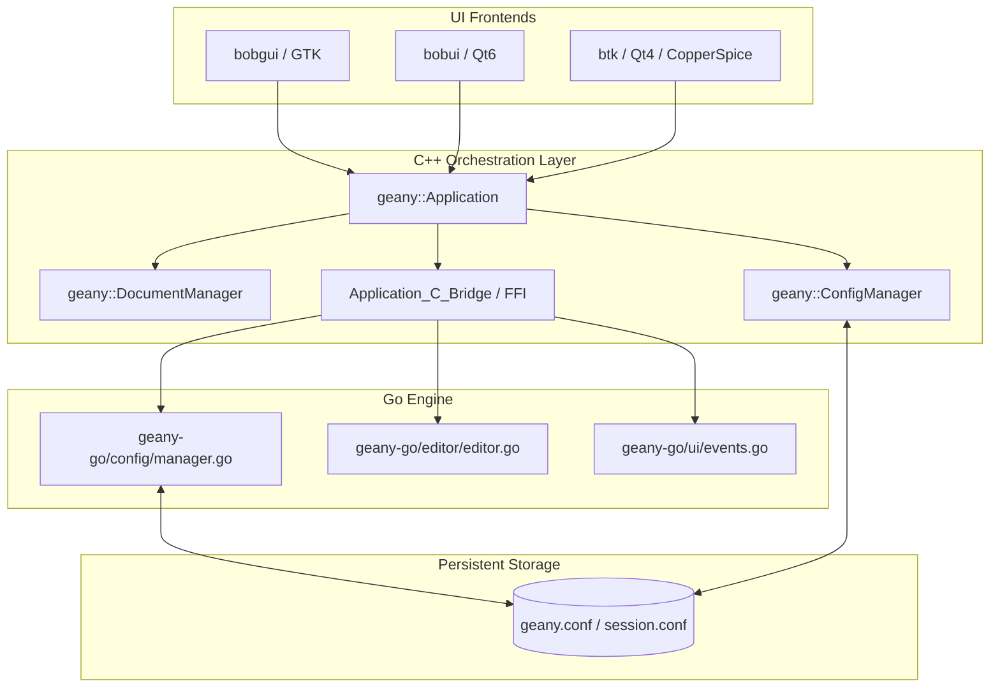

# Design: Geany Session Management and Configuration Architecture

## Context

Geany Ultra is modernizing legacy configuration handling (`src/keyfile.c`, `src/prefs.c`) and document session persistence by migrating core storage, serialization, and lifecycle management into type-safe modern C++ (`geany::ConfigManager`) and an idiomatic Go backend (`geany-go/config`). Simultaneously, the project supports multi-toolkit frontends (`subprojects/bobgui` GTK, `subprojects/bobui` Qt6, and `subprojects/btk` Qt4/CopperSpice).

To ensure consistency, Notepad++ parity, and zero regression across all UI variants, session state (open files, cursor coordinates, selections, folds, bookmarks, and active tabs) and application settings must flow through a unified configuration and session pipeline.

---

## Architectural Overview

---

## Design Goals

1. **Dual-Stack Configuration Parity**: Keep C++ `geany::ConfigManager` and Go `geany-go/config.Manager` synchronized, allowing both runtimes to load, read, mutate, and save standard INI keyfiles (`geany.conf`, `session.conf`).
2. **Toolkit-Agnostic Session Model**: Store all session data in a normalized data model independent of whether the rendering surface is GTK, Qt6, or CopperSpice.
3. **Notepad++ Session Parity**: Support full session restoration:
   - File path and encoding (UTF-8, UTF-16, BOM metadata)
   - Cursor line and column offsets
   - Selection start and end positions
   - Folded block state and active bookmarks
   - Active document index and tab display order
4. **Resilient Thread Safety**: Allow concurrent UI queries and background saves without blocking typing or event handling.
5. **Safe Memory & Error Handling**: Utilize RAII containers (`std::map`, `std::unique_ptr`) and Go mutexes to prevent memory corruption or dangling pointer crashes during sudden shutdowns.

---

## Configuration Schema & Keys

Configuration and session data are organized into clear INI sections:

### 1. `[geany]` / Global Preferences
- `version`: Version string matching `VERSION.md`.
- `tab_orientation`: `0` for Horizontal, `1` for Vertical tabs (Notepad++ / TextFX2 parity).
- `show_document_map`: Boolean indicating whether the Minimap is visible.
- `multiline_tabs`: Boolean for multi-row tab headers.
- `theme`: UI color scheme and styling definition.

### 2. `[session]` / Session Index
- `active_document`: Integer index or file path of the currently focused document.
- `document_count`: Total number of restored documents.
- `split_view`: Boolean flag indicating split notebook layout.

### 3. `[document_N]` / Individual File States
Each open document in the session has a numbered section:
- `path`: Full canonical filesystem path to the file.
- `encoding`: Normalized encoding name (e.g., `UTF-8`, `ISO-8859-1`).
- `cursor_pos`: Absolute byte index or line/col coordinates (`line:col`).
- `selection_start`: Start offset of highlighted text.
- `selection_end`: End offset of highlighted text.
- `folded_lines`: Comma-separated list of collapsed line numbers.
- `bookmarks`: Comma-separated list of marked line bookmarks.

---

## Cross-Language Data Flow

1. **Startup / Session Restore**:
   - `geany::Application::Initialize` loads `geany.conf` and `session.conf`.
   - The C++ layer invokes `GeanyGo_Config_GetString` or native file load in `geany-go/config`.
   - Document paths are dispatched via `GeanyGo_Editor_OpenDocument` or `geany-go/ui/events.go` (`EventDocOpened`).
   - The active UI adapter (`bobgui`, `bobui`, or `btk`) instantiates the tabs and text editors, restoring caret offsets and selections.

2. **Real-Time Mutation**:
   - As preferences are modified via the settings UI or dashboard, changes are recorded using `GeanyGo_Config_SetString` / `geany::ConfigManager::SetString`.
   - The UI Event Dispatcher broadcasts `EventThemeChanged` or `EventTabChanged` to update all visible views simultaneously.

3. **Shutdown / Session Persistence**:
   - `geany::Application::Quit` iterates over active documents in `geany::DocumentManager` and `geany-go/editor`.
   - Current tab order and cursor state are serialized to disk via `ConfigManager::SaveToFile` / `config.Manager.Save`.
   - Custom safe string deallocators (`GeanyGo_FreeString`, `GeanyRust_FreeString`) release FFI memory cleanly.

---

## Implementation Strategy & Migration Plan

- **Step 1 (Completed)**: Bootstrapped `geany-go/config` and C++ `ConfigManager` with INI keyfile parsing and tests.
- **Step 2 (Completed)**: Established UI `EventDispatcher` in `geany-go/ui/events.go` and connected to lifecycle events.
- **Step 3 (Current)**: Documented session schema and multi-toolkit integration pathways.
- **Step 4 (Future)**: Expand `geany-go/editor` to serialize and deserialize multi-document sessions into `session.conf` on application boot/shutdown across all three UI submodules.
