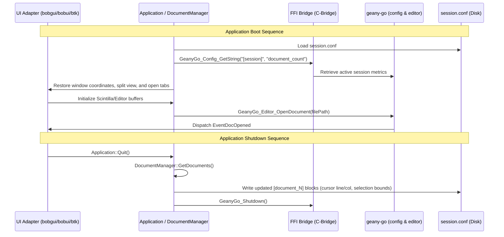

# Implementation Notes: Geany Session Management & Configuration Architecture

## Overview

This document describes the concrete implementation details of configuration loading, serialization, and session state persistence across Geany Ultra's C++ orchestrator, Go backend (`geany-go`), and native UI submodules (`subprojects/bobgui`, `subprojects/bobui`, `subprojects/btk`).

---

## Codebase Components

### 1. Modern C++ Configuration Manager
- **Files**: `src/ConfigManager.h`, `src/ConfigManager.cpp`
- **Responsibilities**:
  - Replaces legacy GLib `GKeyFile` / `src/keyfile.c` calls with a clean STL-based architecture.
  - Houses the in-memory map: `std::map<std::string, std::map<std::string, std::string>> m_config`.
  - Exposes typed helpers: `GetString()`, `SetString()`, `GetInt()`, `SetInt()`, `GetBool()`, `SetBool()`.
  - Serializes configuration buffers to disk via `std::ofstream` and loads from `std::ifstream`, ignoring whitespace and comment markers (`#`, `;`).

### 2. Idiomatic Go Configuration Engine
- **Files**: `geany-go/config/manager.go`, `geany-go/config/manager_test.go`
- **Responsibilities**:
  - Parses INI-style keyfiles with section partitioning (`[geany]`, `[session]`, `[document_N]`).
  - Supports fallback resolution for undefined keys.
  - Tested with unit tests covering full file lifecycle: round-trip write and read (`TestConfigManagerLoadSave`).

### 3. FFI Integration & C-Bridge
- **Files**: `geany-go/main.go`, `src/Application_C_Bridge.h`, `src/Application.cpp`
- **Exported Symbols**:
  - `GeanyGo_Config_SetString(section, key, value)`
  - `GeanyGo_Config_GetString(section, key, fallback)` -> returns allocated C-string.
  - `GeanyGo_FreeString(str)` -> releases memory allocated across the FFI boundary safely.
  - `GeanyGo_UI_DispatchEvent(eventType, payload)` -> notifies frontends of preference mutations.

---

## Session Tracking Protocol

When the application boots or terminates, document session tracking is handled through the following lifecycle flow:

---

## Configuration Schema Details

1. **Global Configuration (`geany.conf`)**:
   - `[geany]`
     - `version`: Global version string matching `VERSION.md`.
     - `tab_orientation`: `0` for horizontal, `1` for vertical tabs.
     - `show_document_map`: Boolean for Minimap display.
     - `multiline_tabs`: Boolean for multi-row tab rendering.
     - `theme`: UI color palette selection.

2. **Session Persistence (`session.conf`)**:
   - `[session]`
     - `active_document`: File path or index of currently focused buffer.
     - `document_count`: Count of open documents.
   - `[document_N]`
     - `path`: Absolute or canonical path to file.
     - `encoding`: File character encoding (UTF-8, UTF-16, ISO-8859).
     - `cursor_pos`: Absolute byte or character offset.
     - `selection_start`: Start offset of current selection range.
     - `selection_end`: End offset of current selection range.
     - `bookmarks`: Comma-separated list of active line bookmark indices.

---

## Test Verification

- `cd geany-go && go test ./config/...`: Validates parser and serializer robustness.
- `cd geany-go && go test ./ui/...`: Validates UI EventDispatcher and submodule integration (`bobui`, `btk`, `bobgui`).
- `cd geany-rust && cargo test`: Validates TextFX and tab manager parity.
